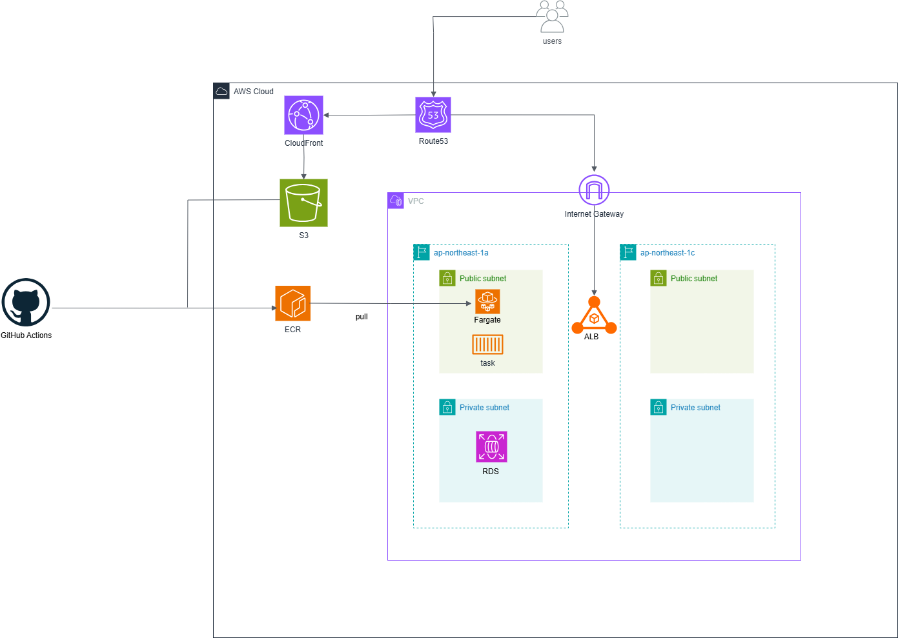

# Juku Cloud

English | [日本語](README.ja.md)

A SaaS for small tutoring schools. Teachers share each student's traits and lesson handoff notes, so lessons stay consistent no matter who teaches.

> **Status:** no longer online. I built it in 2025 and ran it on AWS. This README describes how it was designed and built.

| Repository | Stack |
| --- | --- |
| [juku-cloud-frontend](https://github.com/Taira0222/juku-cloud-frontend) | React 19 · TypeScript · Vite |
| [juku-cloud-backend](https://github.com/Taira0222/juku-cloud-backend) | Ruby on Rails 8 (API mode) · PostgreSQL 15 |


## Why I built it

I ran a tutoring school for three years. In one-on-one tutoring, how you teach depends on the student: some say "I get it" when they don't, and some only focus when the lesson feels fun. Teachers learn these traits, but they rarely write them down, so when another teacher takes over, the lesson feels off. Juku Cloud makes those traits and handoff notes explicit and shared.

## What it does

- **Student dashboard:** each student's strengths and watch-outs, and handoff notes by subject
- **Handoff notes:** teachers create and edit them; only admins delete them. Deleting a subject also deletes its notes, so the UI asks first
- **Student and teacher management** for admins
- **Invite-only sign-up:** teachers join with a signed invite token
- **Role-based access:** teachers only see the students they teach

## Architecture

```
Browser
  │
  ├─ CloudFront ── S3            React SPA (static)
  │
  └─ ALB (HTTPS, ACM) ── ECS Fargate (Rails API) ── RDS PostgreSQL (private subnet)
```



| Decision | Why | Trade-off |
| --- | --- | --- |
| SPA + Rails API mode | The users are not technical, so screens should feel like an app. The API can also serve a mobile app later | Two deploys instead of one |
| ECS Fargate | No servers to patch, and rolling deploys out of the box | Costs more than a PaaS such as Render |
| No NAT gateway | Cost. Tasks run in public subnets, and security groups only allow ALB → ECS → RDS | Moving tasks to private subnets needs NAT or VPC endpoints |
| Single-AZ RDS | Enough for a school's load | Can switch to Multi-AZ later |
| Token auth (devise_token_auth) | A stateless API with no cookie-based CSRF exposure | Tokens in localStorage are exposed to XSS, so CloudFront sets a strict CSP (`script-src 'self'`) |
| HMAC-SHA256 invite tokens | Tamper-proof, and can be looked up directly | bcrypt hashes can't be looked up; MessageVerifier tokens are long |

## Quality

| | Front end | Back end |
| --- | --- | --- |
| Tests | Vitest, Testing Library, MSW | RSpec |
| Coverage | statements 96%, branches 84% | lines 97%, branches 90% |
| CI on every push | ESLint, tests, `npm audit` | tests, RuboCop, Brakeman, bundler-audit |

- N+1 queries were caught with Bullet and fixed with `preload`, `upsert_all` and `delete_all`.
- Deploys used GitHub Actions with OIDC, so there were no long-lived AWS keys. The API went to ECR and ECS and ran `db:migrate` after each deploy. The SPA went to S3, with a long cache for hashed assets and no cache for `index.html`. These deploy jobs are switched off now.
- Database passwords and the Rails master key were kept in Secrets Manager.

## What I'd do next

- A master role to manage schools and admins, and invite admins the same way as teachers
- Email change and password reset
- Move the remaining teacher screens from Zustand to TanStack Query for server state

## About the project

- Built solo, July to October 2025: planning, design, front end, back end, infrastructure and CI/CD
- To run it locally, see the [front end](https://github.com/Taira0222/juku-cloud-frontend#run-locally) and [back end](https://github.com/Taira0222/juku-cloud-backend#run-locally) repositories (both use Dev Containers)
- The full write-up in Japanese has user personas, screen recordings, the ER diagram and design notes: [README.ja.md](README.ja.md)
